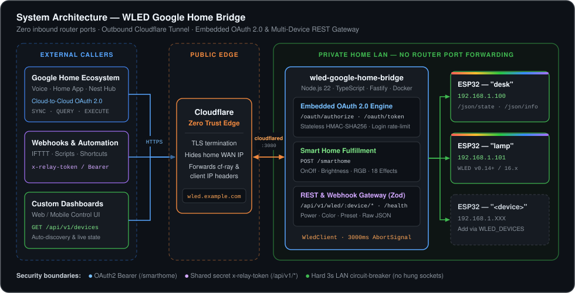

# Fabsoft WLED Google Home Bridge

[](https://github.com/fabsoftx/wled-google-home-bridge/actions/workflows/ci.yml)
[](LICENSE)
[](https://nodejs.org/)
[](https://www.typescriptlang.org/)
[](Dockerfile)

A resilient, self-hosted Node.js/TypeScript microservice that bridges external
triggers (native Google Smart Home Cloud-to-Cloud, Cloudflare Tunnel webhooks,
automation engines, and custom dashboards) to one or more ESP32 strips running
WLED on your local LAN.

**Full usage guide: [docs/USAGE.md](docs/USAGE.md)** — mental model,
detailed endpoint reference, `/raw` command recipes, error codes, runbook.

**Google Home: [docs/GOOGLE_HOME.md](docs/GOOGLE_HOME.md)** — native
Cloud-to-Cloud integration (embedded OAuth2 account linking + `/smarthome`
fulfillment), so devices appear as light tiles in the Google Home app with no
third-party middleman.

## Architecture



## Features

- Native Google Smart Home Cloud-to-Cloud fulfillment (OnOff, Brightness, RGB Color, 18 Effects)
- Multi-device routing via a single `.env` variable (`WLED_DEVICES`)
- Fastify + Zod request validation
- Native `fetch` with a hard `AbortSignal.timeout()` per WLED call
- Structured JSON logging via pino (`pino-pretty` in development)
- Shared-secret auth (`x-relay-token` header or Bearer token) for REST routes
- Stateless HMAC-SHA256 OAuth tokens that survive container recreates
- Never crashes on WLED drop-outs, malformed JSON, or rejected promises

## Quick start

```bash
cp .env.example .env   # set WLED_HOST / WLED_DEVICES, API_AUTH_TOKEN, etc.
npm install
npm run build
```

Development (auto-reload, pretty logs):

```bash
NODE_ENV=development npm run dev
```

## Run with Docker

```bash
docker build -t wled-relay .
docker run -d --name wled-relay --restart unless-stopped \
  --env-file .env -p 3080:3080 wled-relay
```

Note: `--env-file` is read at container **creation**, so `docker restart`
will not pick up `.env` changes. After editing `.env`, recreate:

```bash
docker rm -f wled-relay
docker run -d --name wled-relay --restart unless-stopped \
  --env-file .env -p 3080:3080 wled-relay
```

## Run with PM2

```bash
npm run build
pm2 start ecosystem.config.cjs
pm2 save                 # persist the process list
pm2 startup              # print the command to resurrect on boot (run it once)
pm2 logs wled-relay      # tail logs (./logs/*.log per ecosystem.config.cjs)
```

## Authentication

If `API_AUTH_TOKEN` is set, all `/api/v1/*` routes require either
`x-relay-token: <token>` or `Authorization: Bearer <token>`; `/health` stays
open. `ALLOW_LOCAL_UNAUTHENTICATED=true` lets plain loopback requests skip the
check — requests coming through `cloudflared` are still challenged (detected via
`cf-ray`/`cf-connecting-ip` headers, since the tunnel makes everything look
like localhost).

## API

Base prefix: `/api/v1`. Errors return
`{ "success": false, "code": "...", "message": "..." }` — `502 TARGET_UNREACHABLE`
when the ESP32 doesn't respond, `400 VALIDATION_ERROR` for bad payloads.

| Endpoint | Description |
|---|---|
| `GET /health` | Service status, uptime, default WLED reachability (cached 10s) |
| `GET /api/v1/devices` | List configured devices and their live connectivity |
| `GET /api/v1/wled/status` | Power, brightness, preset, LED count, Wi-Fi RSSI |
| `POST /api/v1/wled/power` | `{ "on": true\|false\|"toggle" }` |
| `GET /api/v1/wled/toggle` | Toggle power (GET-friendly for webhooks) |
| `POST /api/v1/wled/brightness` | `{ "value": 0-255, "relative"?: bool }` — with `relative`, value may be `-255..255` and is applied as a delta |
| `GET\|POST /api/v1/wled/preset/:id` | Apply WLED preset `id` (1–250) |
| `POST /api/v1/wled/color` | `{ "hex": "#RRGGBB" }` or `{ "rgb": [r,g,b] }`, optional `"segment"` |
| `POST /api/v1/wled/effect` | `{ "effectId": n, "speed"?, "intensity"?, "paletteId"?, "segment"? }` |
| `POST /api/v1/wled/raw` | Forwards an arbitrary WLED JSON state object verbatim |
| `GET\|POST /oauth/authorize` | Google account-linking login page (only when Google vars are set) |
| `POST /oauth/token` | OAuth token exchange / refresh for Google |
| `POST /smarthome` | Google Smart Home fulfillment (SYNC/QUERY/EXECUTE/DISCONNECT) |

## Multiple devices

Every `/api/v1/wled/*` route also exists in device-scoped form:
`/api/v1/wled/<device>/*`. Configure devices with `WLED_DEVICES`:

```env
WLED_DEVICES=desk=192.168.1.100,lamp=192.168.1.101
```

`WLED_HOST` is a convenience for the single-device case — it registers a
device named `default` even when `WLED_DEVICES` is also set (unless a device
is explicitly named `default`).

The device named `default` (or the first one listed) answers the un-prefixed
routes, so `/api/v1/wled/power` and `/api/v1/wled/desk/power` can coexist.
Unknown device names return `404 UNKNOWN_DEVICE`. Adding a device is one
`.env` line plus a container recreate — no code changes.

Device names: lowercase `a-z`, `0-9`, `-`, unique, and cannot be `status`,
`power`, `toggle`, `brightness`, `preset`, `color`, `effect`, `raw`, or
`devices` (they collide with route paths).

## curl examples

```bash
export TOKEN="your-secret"   # only needed if API_AUTH_TOKEN is set
H="x-relay-token: $TOKEN"

curl http://localhost:3080/health
curl -H "$H" http://localhost:3080/api/v1/wled/status

curl -H "$H" -X POST http://localhost:3080/api/v1/wled/power \
  -H 'content-type: application/json' -d '{"on":"toggle"}'

curl -H "$H" "http://localhost:3080/api/v1/wled/toggle"

curl -H "$H" -X POST http://localhost:3080/api/v1/wled/brightness \
  -H 'content-type: application/json' -d '{"value":160}'

curl -H "$H" -X POST http://localhost:3080/api/v1/wled/brightness \
  -H 'content-type: application/json' -d '{"value":-40,"relative":true}'

curl -H "$H" http://localhost:3080/api/v1/wled/preset/3

curl -H "$H" -X POST http://localhost:3080/api/v1/wled/color \
  -H 'content-type: application/json' -d '{"hex":"#FF8800"}'

curl -H "$H" -X POST http://localhost:3080/api/v1/wled/effect \
  -H 'content-type: application/json' -d '{"effectId":9,"speed":128,"intensity":200}'

curl -H "$H" -X POST http://localhost:3080/api/v1/wled/raw \
  -H 'content-type: application/json' -d '{"on":true,"seg":[{"fx":66,"pal":11}]}'

# device-scoped variants (same routes, device name after /wled/)
curl -H "$H" http://localhost:3080/api/v1/devices
curl -H "$H" http://localhost:3080/api/v1/wled/desk/status
curl -H "$H" -X POST http://localhost:3080/api/v1/wled/desk/power \
  -H 'content-type: application/json' -d '{"on":true}'
```

## License

[MIT](LICENSE)

## Attribution

Architected by [**Idris Fabiyi Snr**](https://fabiyi.com) — Senior Software Architect

An open-source [**Fabsoft X**](https://github.com/fabsoftx) project · [**Fabs Group**](https://thefabsgroup.co.uk) ([thefabsgroup.co.uk](https://thefabsgroup.co.uk))
